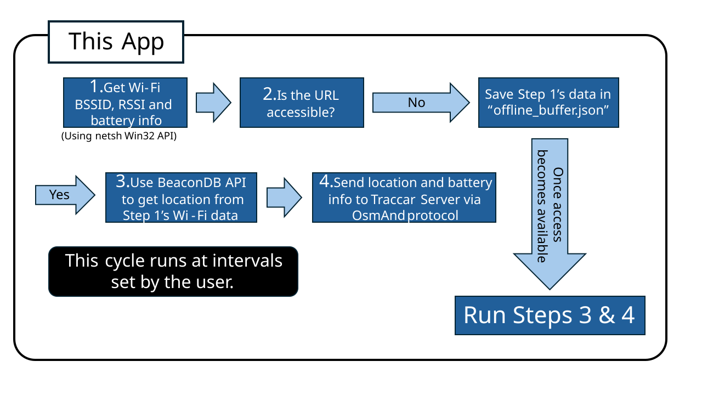

# Traccar Client For Windows
　このアプリはWindowsで動作するTraccar Clientです。Android IOSのTraccar Clientと同じように、位置情報を取得してTraccarサーバーに送信することができます。ただし、すべての機能が実装されているわけではありません。  
ユーザが設定するサーバ以外に**位置情報は送信**しません。周辺のWi-Fi AP情報(BSSID,RSSI)は**位置情報取得**のために[BeaconDB](https://api.beacondb.net/v1/geolocate)に送信されます。
## 機能
このアプリケーションに搭載されている機能は以下の通りです。
- ユーザが設定するTraccarサーバーに位置情報・バッテリ残量の送信
- デバイス名・送信間隔のカスタマイズ
- カスタマイズ(設定)の保存
- バックグラウンドでの位置情報送信
- オフライン時の位置情報のバッファ
## 動作概要
　ユーザ設定はconfig.jsonに保存されます。アプリは起動時にconfig.jsonを読み込みます。設定された間隔で位置情報の取得、送信を行います。位置情報の取得・送信の流れ(今すぐ送信を押したときの動作)を文字と図で説明します。

### 1.Wi-Fi情報・バッテリ情報の取得
　アプリははじめに、netshコマンドより、周辺のWi-Fi APのBSSID(MACアドレス)と信号強度(RSSI)を取得します。  
　バッテリ残量・バッテリ充電状態は、Win32 APIより取得します。
### 2.位置情報の取得
　アプリはユーザの設定するTraccarサーバに送信可能かを確認し、オンラインかどうか判定します。もし、オフラインであれば、(1)で取得したWi-Fi情報・バッテリ情報・(2)で取得した位置情報・時刻をローカル(offline_buffer.json)に保存します。オンラインであることを確認すると、(1)で取得したWi-FiのBSSIDとRSSIを[BeaconDBのAPI](https://api.beacondb.net/v1/geolocate)に送信し、位置情報(経度・緯度)と精度を取得します。
### 3.位置情報の送信
　オンラインであれば、位置情報、精度、バッテリ残量をユーザの設定するTraccarサーバーに送信します。プロトコルはOsmAndです。クエリパラメータ(deviceid lat lon timestamp batt charg accuracy)としてHTTP GETで送信されます。
### 4.オフライン時のバッファの送信
　この処理は、ユーザが設定するTraccarサーバに送信可能かを確認すると行われます。offline_buffer.jsonに保存されたデータをBeaconDBより位置情報を取得し、Traccarサーバに送信します。送信が成功したデータは、offline_buffer.jsonから削除されます。